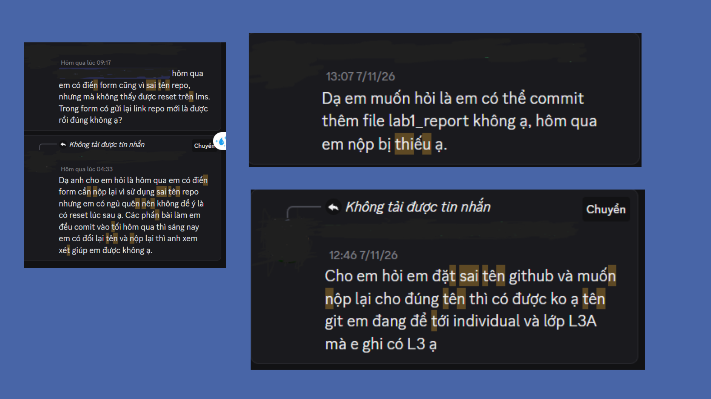
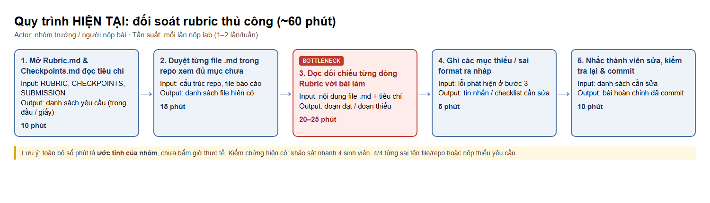
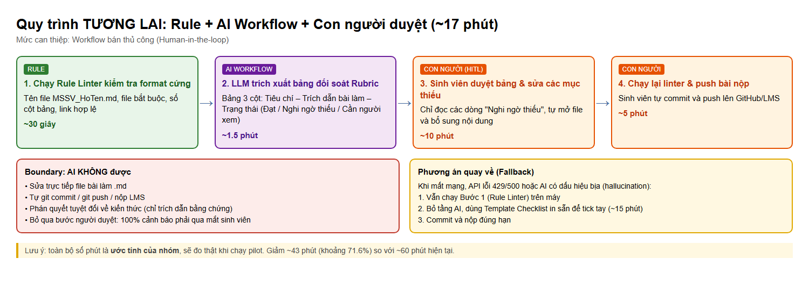

# Báo cáo nhóm — Day 02 Discovery & Problem Framing

> Bản chung của nhóm, viết trên repo do nhóm trưởng fork. Không copy file này sang repo cá nhân.
> Template chi tiết và prompt mẫu: [docs/01-worksheet.md](../../docs/01-worksheet.md). Bài mẫu: [docs/02-deliverable-example.md](../../docs/02-deliverable-example.md).

## 1. Thông tin nhóm

- Tên nhóm: NhomDragon
- Thành viên: Đào Quang Huy - 2A202603642, Hoàng Hải Long - 2A202603670
- Candidate problem được chọn (1 câu): Đối soát rubric và tài liệu yêu cầu với các file bài nộp lab kỹ thuật để phát hiện thiếu sót và lỗi format trước deadline.
- Quyết định cuối: Go (Workflow bán thủ công phạm vi hẹp)

**Bối cảnh / Nhân vật:** Sinh viên ngành Công nghệ thông tin / Nhóm trưởng nhóm lab kỹ thuật tại trường đại học (nhóm Dragon). Mỗi tuần, nhóm phải hoàn thành các bài lab kỹ thuật, làm việc cộng tác qua GitHub, viết các báo cáo định dạng Markdown và chịu trách nhiệm đối soát toàn bộ nội dung với tài liệu Rubric chấm điểm của giảng viên trước deadline.

**Vì sao đây là bài toán tốt:** Actor cụ thể (sinh viên nộp bài / nhóm trưởng); quy trình lặp lại đều đặn mỗi tuần; bottleneck rất rõ ràng ở khâu đọc đối chiếu chi tiết từng tiêu chí (20–25 phút); có baseline thời gian do nhóm ước tính (~60 phút, chưa bấm giờ thực tế); so sánh được rõ ràng 4 mức No AI / Rule / Workflow / Agent; và quan trọng nhất, **kết quả research cùng phản biện của nhóm làm nhóm đổi kết luận** (từ định xây AI Agent tự động sửa bài chuyển sang Workflow bán thủ công kết hợp Rule linter).

---

## 2. Hội tụ nhóm (CP3)

### 2.1. Pitch

Nhóm 2 thành viên, Huy pitch 3 problem và Long pitch 2 problem (tổng cộng 5 candidate):

| # | Người đưa ra | Candidate (Job Story ngắn) | Actor | Bottleneck | Câu hỏi phản biện nhận được (ai hỏi) |
|---:|---|---|---|---|---|
| 1 | Huy | Khi chuẩn bị nộp bài lab trước hạn 2 tiếng, tôi muốn đối soát file bài làm với rubric chấm điểm, để không bị mất điểm oan do thiếu mục hoặc sai format | Sinh viên nộp bài | Đọc đối chiếu chi tiết từng dòng rubric với nội dung bài nộp (20–25') | "Rubric có tiêu chí định tính (ví dụ 'lập luận chặt') thì đối soát tự động kiểu gì mà không bị hallucinate?" (Long hỏi) |
| 2 | Huy | Khi gặp lỗi cấu hình môi trường hoặc bug thư viện lạ, tôi muốn tìm nhanh giải pháp từ GitHub Issue/Discord, để sửa lỗi và code tiếp | Sinh viên lập trình | Đọc và sàng lọc 5–10 thread dài hàng chục comment để tìm đúng phiên bản OS/library (25–30') | "Lỗi lạ trên máy cá nhân mỗi người một kiểu, dữ liệu tìm kiếm phân mảnh thì làm sao đảm bảo giải pháp đưa ra chạy được?" (Long hỏi) |
| 3 | Huy | Khi đến hạn báo cáo tiến độ đồ án mỗi tuần, tôi muốn tổng hợp các commit/PR hoàn thành thành văn bản, để báo cáo mentor đúng hạn | Nhóm trưởng | Tổng hợp narrative (thành tựu, việc chưa xong, blocker) từ git log sơ sài (25–30') | "Nếu commit message viết ẩu kiểu 'fix bug', 'update' thì lấy thông tin đâu ra để viết narrative?" (Long hỏi) |
| 4 | Long | Khi cả nhóm cùng code một đồ án trên GitHub và sắp đến hạn demo, tôi muốn chia task rõ ràng theo file/module, để các thành viên không sửa đè lên nhau và không phải gỡ merge conflict phút chót | Nhóm trưởng / thành viên nhóm đồ án | Gỡ merge conflict và ghép code của nhiều người trước giờ demo (~30') | "Merge conflict là vấn đề về kỷ luật git và giao tiếp nhóm, công nghệ có can thiệp được tận gốc không?" (Huy hỏi) |
| 5 | Long | Khi chuẩn bị demo sản phẩm trên máy khác (máy giảng viên, máy bạn cùng nhóm), tôi muốn cài môi trường chạy được ngay, để demo không bị chết giữa chừng vì thiếu thư viện hoặc sai phiên bản | Sinh viên lập trình / nhóm demo | Chạy thử, đọc lỗi và cài lại thư viện/phiên bản trên máy demo (~30') | "Docker hoặc file requirements.txt chuẩn đã giải quyết việc setup demo rồi, bài toán đó có thực sự cần thiết kế mới không?" (Huy hỏi) |

### 2.2. Cluster

Gom 5 candidate thành 3 cụm theo bản chất vấn đề:

| Cluster | Các candidate | Pattern chung |
|---|---|---|
| **A: Đảm bảo chất lượng & Tuân thủ quy chuẩn nộp bài** | #1 (Đối soát rubric bài lab) | Nỗi đau đối soát văn bản và tiêu chuẩn trước deadline; dữ liệu đầu vào có sẵn (file markdown bài làm + rubric môn học); tần suất cao (mỗi tuần 1–2 lab); ảnh hưởng trực tiếp đến điểm số |
| **B: Tìm kiếm tri thức kỹ thuật & Debug lỗi** | #2 (Tìm giải pháp bug thư viện), #5 (Setup môi trường demo) | Nỗi đau tìm kiếm thông tin kỹ thuật phân mảnh; thời gian tiêu tốn lớn nhưng ngữ cảnh đa dạng, khó kiểm soát tính chính xác |
| **C: Quản lý cộng tác nhóm & Báo cáo** | #3 (Tổng hợp báo cáo tuần từ git), #4 (Chia task & tránh conflict) | Nỗi đau giao tiếp và tổng hợp trạng thái làm việc của con người; dữ liệu phụ thuộc nhiều vào thói quen/kỷ luật cá nhân |

### 2.3. Opportunity Solution Tree rút gọn

Gốc là **1 outcome duy nhất**. Nhánh là **opportunity** (nhu cầu, nỗi đau), không phải tính năng hay công cụ.

```text
OUTCOME: Giảm 70% thời gian rà soát & chuẩn bị bài nộp lab kỹ thuật mà không bị trừ điểm oan do lỗi cấu trúc/nội dung
├── Opportunity A: Sinh viên mất quá nhiều thời gian đọc đối chiếu thủ công từng tiêu chí Rubric với file bài làm trước giờ nộp
├── Opportunity B: Sinh viên dễ bỏ sót các quy định ngầm (naming file, vị trí thư mục, con số chứng minh) do mệt mỏi và áp lực deadline
└── Opportunity C: Khó khăn trong việc phát hiện những phần nội dung viết quá sơ sài hoặc thiếu bằng chứng định lượng trước khi nộp
```

Những ý đã gạch bỏ vì là solution đội lốt opportunity:

- ~~"Xây dựng Chatbot AI tự động sửa toàn bộ lỗi trong file bài nộp"~~ *(Solution trá hình, can thiệp thô bạo và rủi ro vi phạm liêm chính học thuật)*
- ~~"Tool tự động generate code giải bài lab"~~ *(Solution trá hình, không giải quyết vấn đề quy trình nộp bài)*
- ~~"Script tự động commit và push bài lên LMS"~~ *(Tính năng tự động hóa cơ học, không giải quyết khâu kiểm soát chất lượng nội dung)*

### 2.4. Chấm điểm shortlist (1–5)

Chọn 3 candidate đại diện cho 3 cụm để chấm điểm:

| Candidate | Actor rõ | Quy trình rõ | Pain có bằng chứng | Impact đo được | Vừa sức lab | So sánh được No AI/Rule/Workflow/Agent | Nhóm hiểu domain | Tổng |
|---|---:|---:|---:|---:|---:|---:|---:|---:|
| **#1: Đối soát rubric bài lab (Cluster A)** | 5 | 5 | 5 | 5 | 5 | 5 | 5 | **35** |
| **#2: Tìm giải pháp bug thư viện (Cluster B)** | 4 | 3 | 4 | 4 | 3 | 3 | 4 | **25** |
| **#3: Tổng hợp báo cáo tuần từ git (Cluster C)** | 4 | 4 | 4 | 3 | 4 | 4 | 4 | **27** |

**Candidate được chọn:**
Candidate #1: **Đối soát rubric và tài liệu yêu cầu với các file bài nộp lab kỹ thuật để phát hiện thiếu sót và lỗi format trước deadline.**

**Vì sao chọn:**
1. **Điểm cao nhất (35/35)**: Actor rất cụ thể (sinh viên IT/nhóm trưởng), quy trình các bước chuẩn bị nộp bài rõ ràng, dễ vẽ.
2. **Impact đo lường được trực tiếp**: Giảm thời gian đọc đối soát từ ~60 phút xuống < 20 phút (cả hai đều là ước tính của nhóm); đo được tỷ lệ phát hiện thiếu sót và số lỗi bị trừ điểm.
3. **Phù hợp hoàn hảo để so sánh 4 mức can thiệp**: Có thể thấy ngay ranh giới giữa Rule (kiểm tra định dạng, regex tên file, số cột bảng) vs. Workflow (dùng LLM trích xuất checklist và đối chiếu ngữ nghĩa) vs. Agent (không cần thiết).
4. **Vừa sức trong 1 buổi lab**: Cả nhóm đều là sinh viên đang trải qua chính nỗi đau này ngay tại buổi lab hôm nay.

**Vì sao loại các candidate còn lại:**
- **Loại #2 (Tìm giải pháp bug thư viện)**: Ngữ cảnh lỗi quá rộng, phụ thuộc vào hàng ngàn biến số môi trường OS/hardware. AI dễ đưa ra giải pháp "ảo giác" (hallucination) có thể làm hỏng thêm môi trường làm việc của sinh viên.
- **Loại #3 (Tổng hợp báo cáo tuần từ git)**: Đầu vào git log thường rất sơ sài nếu thành viên không có thói quen commit chuẩn. Vấn đề gốc nằm ở kỷ luật làm việc chứ không hẳn ở công cụ tổng hợp.

**Xử lý bất đồng (nếu có):**
Ban đầu Long băn khoăn liệu đối soát tự động có phát hiện được các tiêu chí định tính của rubric không. Nhóm đã thống nhất giải quyết bằng cách: **Phân chia ranh giới rõ ràng** – Rule xử lý format cơ học, AI trích xuất checklist và chỉ ra đoạn văn bản liên quan để con người tự đọc và quyết định (Human-in-the-loop), không để AI tự quyết. Long hoàn toàn đồng thuận.

---

## 3. Kiểm chứng + research giải pháp đã có (CP4)

### 3.1. Assumption Map

Nhóm lập danh sách 5 giả định quan trọng nhất và đánh giá mức độ quan trọng (1–5) cùng mức độ bằng chứng đã có (1–5):

| # | Giả định | Loại (Value / Usability / Feasibility / Viability) | Quan trọng (1–5) | Đã có bằng chứng (1–5) | Kiểm chứng trước? |
|---:|---|---|---:|---:|:---:|
| 1 | Sinh viên thực sự mất > 45 phút mỗi lần nộp lab chỉ để đọc đối soát file bài làm với Rubric | Value | 5 | 4 | Có |
| 2 | Sinh viên thường xuyên bị mất điểm oan do lỗi cấu trúc file hoặc sót mục checklist nhỏ chứ không phải do không hiểu bài | Value | 5 | 3 | **Có (Kiểm chứng trước)** |
| 3 | Người dùng sợ nhất là công cụ báo lỗi giả (false positive) khiến họ hoang mang sửa sai sát giờ nộp | Usability | 5 | 2 | **Có (Kiểm chứng trước)** |
| 4 | LLM có khả năng phân tích ngữ nghĩa Rubric tiếng Việt và đối chiếu với file Markdown mà không bị hallucination ở các tiêu chí định tính | Feasibility | 4 | 2 | Có |
| 5 | Các môn học cho phép sinh viên dùng công cụ tự động hỗ trợ rà soát trước khi nộp mà không vi phạm quy chế | Viability | 4 | 4 | Không |

**Giả định nhóm kiểm chứng trong buổi này:**
- **Giả định #2**: Tần suất và mức độ mất điểm do lỗi format/sót checklist rubric.
- **Giả định #3**: Nỗi sợ và rào cản lớn nhất khi dùng công cụ hỗ trợ đối soát bài nộp (đặc biệt là nguy cơ báo nhầm trước deadline).

---

### 3.2. Kiểm chứng

Nhóm kiểm chứng với người thật theo nguyên tắc **The Mom Test** (chỉ hỏi về hành vi và sự việc đã xảy ra, không hỏi giả định tương lai). **Hiện tại mới thực hiện được 1 phương pháp: khảo sát nhanh 4 sinh viên.** Nhóm chưa phỏng vấn sâu buổi nào, vì vậy mọi kết luận bên dưới chỉ là tín hiệu ban đầu từ mẫu rất nhỏ (n = 4), chưa đủ để khái quát.

#### A. Kết quả khảo sát (4 người)

- **4/4 bạn** cho biết từng sai tên file hoặc nộp thiếu yêu cầu so với đề bài/rubric (3 trường hợp sai tên repo/GitHub, 1 trường hợp thiếu file).
- Chưa thu thập số liệu về thời gian rà soát, cách xử lý hiện tại (workaround) hay mức độ lo ngại AI báo nhầm; các nội dung này chưa được kiểm chứng.



Ghi chú chi tiết từng phản hồi: [cp4-survey-snapshot.md](../assets/cp4-survey-snapshot.md).

#### B. Phỏng vấn sâu

Chưa thực hiện. Nhóm sẽ bổ sung ở lần kiểm chứng tiếp theo (xem mục 9).

#### C. Tổng hợp tín hiệu xác nhận & phản bác

| Nguồn | Số người / số mẫu | Tín hiệu xác nhận | Tín hiệu phản bác |
|---|---:|---|---|
| Khảo sát nhanh | 4 sinh viên | 4/4 từng sai tên file hoặc nộp thiếu yêu cầu | Chưa ghi nhận được tín hiệu phản bác nào (mẫu quá nhỏ, chưa hỏi về nỗi lo AI báo nhầm) |

> **Giả định chưa kiểm chứng:** việc sinh viên sợ AI báo nhầm trước deadline và không muốn AI tự sửa bài là giả định của nhóm (rút ra từ phản biện và research), chưa có số liệu khảo sát chứng minh.

**Nhóm đã sửa problem thế nào sau kiểm chứng:**
1. **Thu hẹp phạm vi can thiệp (Boundary)**: Từ ý định ban đầu là "công cụ đánh giá toàn diện bài nộp", nhóm **chuyển thành "Quy trình hỗ trợ đối soát 2 tầng"**:
   - **Tầng 1 (Rule-based)**: Quét sạch 100% lỗi format cơ học (tên file, cấu trúc thư mục, bảng rỗng, thiếu tiêu đề) mà không dùng AI.
   - **Tầng 2 (Workflow LLM)**: Chỉ trích xuất tiêu chí từ rubric thành checklist và highlight đoạn văn bản tương ứng trong bài làm để sinh viên tự xác nhận, **tuyệt đối không để AI tự ý kết luận Đạt/Trượt hoặc tự sửa file**.
2. **Bổ sung tiêu chí an toàn**: Thiết lập cơ chế chống báo nhầm (False Positive) – thà ghi nhận "Cần người xem lại" còn hơn báo sai gây hoang mang trước deadline.

---

### 3.3. Research giải pháp đã có

Nhóm đã tìm kiếm và kiểm tra trực tiếp 3 giải pháp/công cụ tương tự trên thị trường (ghi chú chi tiết: [cp4-research-notes.md](../assets/cp4-research-notes.md)):

| Công cụ / case / pattern | Link đã kiểm chứng | Giải bước nào trong quy trình? | Điểm mạnh | Khoảng trống / rủi ro | Bài học cho nhóm |
|---|---|---|---|---|---|
| **Markdownlint / Super-Linter** (GitHub Action) | [github.com/DavidAnson/markdownlint](https://github.com/DavidAnson/markdownlint) | Kiểm tra định dạng file markdown (tiêu đề, cú pháp, khoảng trắng, link hỏng) | Tốc độ cực nhanh (vài giây), chạy tự động khi git commit/push, độ chính xác 100% theo rule cứng | Hoàn toàn mù tịt về ngữ nghĩa nội dung môn học; không đối soát được với Rubric hay Checkpoints | Dùng Rule cho các tiêu chí format cơ học (tên file, cấu trúc mục, bảng rỗng) là chuẩn nhất, không cần lãng phí AI |
| **Turnitin Rubrics & Grading Tools** | [turnitin.com/products/feedback-studio/rubrics](https://www.turnitin.com/products/feedback-studio/rubrics) | Giảng viên thiết lập ma trận rubric và chấm điểm bài nộp theo tiêu chí | Bảng rubric trực quan, gắn điểm số theo từng mức độ đạt được, chuyên nghiệp | Chỉ phục vụ giảng viên **sau khi đã nộp bài**; sinh viên không thể dùng để tự kiểm tra trước deadline; không hỗ trợ repo Git/Markdown | Cần một công cụ đóng vai trò "Pre-flight Check" (kiểm tra trước khi cất cánh) dành riêng cho sinh viên |
| **Workaround: ChatGPT / Claude Custom Prompt** | [chatgpt.com](https://chatgpt.com) | Sinh viên copy Rubric + nội dung bài nộp nhờ AI rà soát lỗi thiếu sót | Đọc hiểu tiếng Việt tốt, chỉ ra được các điểm thiếu sót về mặt lập luận | Dễ bị hallucination (bịa tiêu chí ngoài rubric); giới hạn context khi nộp nhiều file; không có ranh giới an toàn | Không để AI tự do chat; phải chuẩn hóa thành một Workflow có cấu trúc: Input cố định $\rightarrow$ Prompt đối chiếu trích dẫn $\rightarrow$ Output dạng bảng kiểm tra |

---

## 4. Quy trình trước/sau (CP5)

### 4.1. Quy trình hiện tại

> **Lưu ý:** Toàn bộ số phút trong mục 4 là **ước tính của nhóm**, chưa bấm giờ thực tế.

Sơ đồ quy trình hiện tại (Thủ công — ~60 phút ước tính):



```text
HIỆN TẠI — Tổng thời gian: ~60 phút (ước tính)

[Bước 1: Mở Rubric.md & Checkpoints.md đọc tiêu chí] (10')
       ↓
[Bước 2: Mở duyệt từng file .md trong repo xem đủ mục chưa] (15')
       ↓
[Bước 3: Đọc đối chiếu chi tiết từng dòng Rubric với bài làm] (20') ← BOTTLENECK CHÍNH
       ↓
[Bước 4: Ghi chép các mục còn thiếu sót / sai format ra nháp] (5')
       ↓
[Bước 5: Nhắc thành viên sửa lại bài, kiểm tra lại & commit] (10')
```

Bảng mô tả chi tiết từng bước:

| Bước | Actor | Input | Output | Thời gian (ước tính) / tần suất | Ghi chú |
|---:|---|---|---|---|---|
| 1 | Nhóm trưởng / Người nộp | File `RUBRIC.md`, `CHECKPOINTS.md`, `SUBMISSION.md` | Danh sách các yêu cầu trong đầu hoặc ghi tạm ra giấy | 10 phút / Mỗi lần nộp lab (1–2 lần/tuần) | Các tài liệu quy định nằm rải rác ở nhiều file khác nhau |
| 2 | Nhóm trưởng | Cấu trúc thư mục repo, các file báo cáo markdown | Danh sách các file hiện có trong repo | 15 phút / Mỗi lần nộp lab | Phải mở từng file xem tên file đã đúng quy tắc chưa, các heading có đủ không |
| 3 | Người nộp bài | Nội dung từng file markdown + Tiêu chí trong Rubric | Phát hiện đoạn nào đạt, đoạn nào thiếu | **20–25 phút** / Mỗi lần nộp lab | **BOTTLENECK CHÍNH**: Đọc dò từng dòng rất mỏi mắt, dễ bị hoa mắt bỏ sót khi áp lực sát deadline |
| 4 | Người nộp bài | Các lỗi phát hiện được ở Bước 3 | Tin nhắn gửi thành viên hoặc danh sách checklist cần sửa | 5 phút / Mỗi lần nộp lab | Ghi chú thủ công trên Discord/Zalo |
| 5 | Cả nhóm | Danh sách cần sửa + Source code/Report | Bài hoàn chỉnh được commit lên GitHub/LMS | 10 phút / Mỗi lần nộp lab | Chờ thành viên commit lại hoặc nhóm trưởng tự sửa |

**Bottleneck chính:**
Bước 3 (Đọc đối chiếu chi tiết): Mất từ 20 đến 25 phút. Đây là bước gây kiệt sức tinh thần nhất vì người nộp phải vừa đọc hiểu tiêu chuẩn đánh giá của rubric (thường dài 50–100 dòng), vừa lướt qua hàng trăm dòng markdown của nhiều thành viên để tìm kiếm bằng chứng xem đã viết chưa và có đủ số liệu đo lường không.

---

### 4.2. Quy trình tương lai

> **Lưu ý:** Số phút của từng bước bên dưới là ước tính của nhóm, sẽ đo thật khi chạy pilot.

Quy trình tương lai kết hợp **Rule-based Linter (Tầng 1)**, **Workflow LLM hỗ trợ trích xuất (Tầng 2)** và **Con người duyệt (Human-in-the-loop)**:

```text
TƯƠNG LAI — Tổng thời gian: ~17 phút (Bán thủ công, ước tính)

[Bước 1: Chạy Rule Linter tự động kiểm tra format cứng] (30 giây) ───▶ [RULE]
       ↓ (Nếu đạt cấu trúc)
[Bước 2: Workflow LLM trích xuất bảng ma trận đối soát Rubric] (1.5 phút) ───▶ [AI WORKFLOW]
       ↓
[Bước 3: Sinh viên duyệt bảng đối soát & sửa trực tiếp các mục thiếu] (10 phút) ───▶ [HUMAN - HITL]
       ↓
[Bước 4: Chạy linter kiểm tra lại lần cuối & Push bài nộp] (5 phút) ───▶ [HUMAN]
```



**Phân định mức độ can thiệp:**
- **Bước 1 [RULE]**: Script kiểm tra cơ học 100% bằng Rule (kiểm tra regex tên file `MSSV_HoTen.md`, sự tồn tại của các file bắt buộc, số cột bảng, link markdown hợp lệ). Thời gian: 30 giây.
- **Bước 2 [AI WORKFLOW]**: LLM nhận đầu vào là `RUBRIC.md` và các file báo cáo bài nộp `.md`. AI trích xuất checklist tiêu chí và trích dẫn trực tiếp đoạn văn bản tương ứng trong bài làm, xuất ra bảng ma trận:
  `Tiêu chí Rubric | Trích dẫn bài làm | Trạng thái (Đạt / Nghi ngờ thiếu / Cần người xem)`. Thời gian: 1.5 phút.
- **Bước 3 [CON NGƯỜI - HITL]**: Sinh viên mở bảng ma trận đối soát, chỉ cần tập trung rà soát các dòng được gắn cờ "Nghi ngờ thiếu", mở file markdown tương ứng để bổ sung nội dung. Thời gian: 10 phút.
- **Bước 4 [CON NGƯỜI]**: Sinh viên tự thực hiện commit và push bài nộp lên GitHub/LMS. Thời gian: 5 phút.

**Boundary (Ranh giới bất khả xâm phạm của AI):**
1. AI **TUYỆT ĐỐI KHÔNG** được sửa trực tiếp vào file bài làm `.md` của sinh viên.
2. AI **TUYỆT ĐỐI KHÔNG** được tự ý thực hiện lệnh `git commit`, `git push` hay nộp bài lên LMS.
3. AI **KHÔNG** đưa ra phán quyết tuyệt đối về kiến thức chuyên môn; AI chỉ đóng vai trò "người trích dẫn" (citation extractor) chỉ rõ bằng chứng nằm ở dòng nào để con người quyết định.
4. **Human-in-the-loop (HITL)**: Bắt buộc 100% các cảnh báo "Nghi ngờ thiếu" phải qua mắt sinh viên xem xét và tự tay gõ chỉnh sửa nội dung.

**Phương án quay về (Fallback) khi AI gặp sự cố:**
- Nếu mạng mất kết nối, API LLM bị lỗi 429/500, hoặc kết quả AI trả về có dấu hiệu ảo giác (hallucination):
  $\rightarrow$ **Quy trình ngay lập tức chuyển sang chế độ Dự phòng (Fallback Plan)**:
  1. Vẫn cho chạy **Bước 1 (Rule-based Linter)** cục bộ trên máy để đảm bảo 100% không bị trừ điểm lỗi format cơ học.
  2. Bỏ qua Tầng AI, mở **File Checklist Markdown in sẵn (Template Checklist)** để nhóm trưởng tick tay thủ công trong 15 phút.
  3. Kịp thời commit và nộp bài trước hạn mà không bị phụ thuộc vào AI.

---

### 4.3. Before / after

| Chỉ số | Trước (ước tính) | Sau (kỳ vọng, ước tính) | Ghi chú |
|---|---:|---:|---|
| **Số bước** | 5 bước | 4 bước | Gộp việc đọc dò và đối chiếu thành 1 bước duyệt bảng tự động |
| **Tổng thời gian** | ~60 phút | **~17 phút** | **Giảm khoảng 71.6%** (tiết kiệm ~43 phút mỗi lần nộp) — số liệu do nhóm ước tính, chưa đo thật |
| **Số bước thủ công** | 5 / 5 bước (100%) | 2 bước thủ công | Máy làm 2 bước (Rule + AI), người chỉ duyệt và sửa |
| **Bottleneck chính** | Đọc dò bằng mắt từng dòng (20–25') | Sinh viên chỉ đọc các mục "Nghi ngờ thiếu" (10') | Giảm 60% thời gian nghẽn, loại bỏ mỏi mắt |
| **Rủi ro mới phát sinh** | Mệt mỏi, áp lực dẫn đến bỏ sót quy định ngầm | Nguy cơ AI báo nhầm (False Positive) làm sinh viên hoang mang | Đã kiểm soát bằng ranh giới: AI chỉ trích dẫn văn bản, người tự đọc xác nhận |

---

## 5. Problem Statement v0 (CP5)

| Trường | Nội dung |
|---|---|
| **Actor** | Sinh viên ngành Công nghệ thông tin / Nhóm trưởng chịu trách nhiệm nộp bài lab kỹ thuật trên GitHub/LMS |
| **Quy trình** | Quy trình rà soát, kiểm tra sự đầy đủ và tính tuân thủ quy cách của các file bài nộp markdown theo tài liệu Rubric và Checkpoints trước deadline 2 tiếng |
| **Bottleneck** | Bước đọc đối chiếu chi tiết từng tiêu chí định tính và định lượng trong Rubric với từng đoạn nội dung trong các file markdown bài làm (mất 20–25 phút, rất dễ sót do hoa mắt và áp lực cận deadline) |
| **Impact** | Tiêu tốn khoảng 45–60 phút mỗi lần nộp lab (nhóm ước tính); 4/4 sinh viên được khảo sát từng sai tên file hoặc nộp thiếu yêu cầu; gây căng thẳng, hoang mang trong nhóm trước giờ G |
| **Success Metric** | • **Baseline** (nhóm ước tính, chưa đo thật): ~60 phút rà soát thủ công; tỷ lệ phát hiện thiếu sót và số lần bị trừ điểm chưa được đo, sẽ đo khi chạy pilot.<br>• **Target**: Tổng thời gian rà soát giảm xuống < 20 phút (giảm > 65%); Tỷ lệ phát hiện đúng các tiêu chí thiếu sót đạt $\ge 90\%$; 0 bài nộp bị trừ điểm cấu trúc/format.<br>• **Cách đo**: Bấm giờ đồng hồ từ lúc bắt đầu rà soát đến khi hoàn tất commit; đếm số lỗi thiếu sót được phát hiện so với bảng điểm phúc tra thực tế của giảng viên |
| **Boundary** | • AI không được tự động sửa nội dung file báo cáo markdown.<br>• AI không được tự ý commit hoặc nộp bài lên LMS thay sinh viên.<br>• AI không tự phán xét kiến thức; chỉ trích xuất đối chiếu và highlight vị trí văn bản.<br>• **HITL**: Bắt buộc sinh viên phải tự duyệt các mục cảnh báo và tự tay sửa bài làm |

**Phản biện nhận được (từ AI hoặc nhóm khác) và nhóm có đồng ý không:**
- **Phản biện nhận được**: *"Success metric '0 bài nộp bị trừ điểm cấu trúc' là mong muốn kết quả gián tiếp, phụ thuộc vào việc sinh viên sau khi thấy cảnh báo có chịu sửa hay không, chứ công cụ đối soát không trực tiếp quyết định việc sinh viên có sửa bài không."*
- **Nhóm có đồng ý không**: **Đồng ý hoàn toàn**. Nhóm đã bổ sung thêm success metric đo lường trực tiếp năng lực của công cụ: *"Tỷ lệ phát hiện đúng các tiêu chí thiếu sót đạt $\ge 90\%$"* và *"Thời gian rà soát giảm từ ~60' xuống < 20' (ước tính của nhóm)"*.

---

## 6. Mức can thiệp AI (CP6)

### 6.1. Ma trận độ mơ hồ × độ phức tạp

Bài của nhóm nằm ở ô: **Độ mơ hồ Trung bình × Độ phức tạp Thấp**

**Vì sao:**
- **Độ phức tạp Thấp**: Quy trình đối soát gồm 4 bước cố định tuần tự (quét file $\rightarrow$ đối chiếu tiêu chí $\rightarrow$ hiển thị bảng kết quả $\rightarrow$ con người duyệt). Không yêu cầu hệ thống phải lập kế hoạch đa bước động, không cần tương tác nhiều vòng lặp hay gọi công cụ ngoài phức tạp.
- **Độ mơ hồ Trung bình**: Một số tiêu chí rubric có định dạng rõ ràng (tên file, số lượng mục), nhưng một số tiêu chí khác mang tính ngữ nghĩa bán cấu trúc (ví dụ: "có số liệu đo lường cụ thể", "có ít nhất một bằng chứng phản bác"). Do đó Rule cứng không xử lý hết được, cần khả năng đọc hiểu ngữ nghĩa của LLM.

### 6.2. So sánh 4 mức

| Mức | Phương án cho bài của nhóm | Đủ khi nào | Rủi ro | Chọn? |
|---|---|---|---|:---:|
| **No AI** (sửa quy trình) | In sẵn file template checklist Markdown, yêu cầu sinh viên tự tick từng mục trước khi commit | Đủ khi rubric rất ngắn (< 5 tiêu chí), cấu trúc bài đơn giản | Sinh viên vẫn mất trọn 40–50 phút đọc dò thủ công; khi mỏi mắt sát deadline vẫn bỏ sót lỗi | Không |
| **Rule** | Viết script Python/Shell quét regex kiểm tra tên file, số lượng cột bảng, sự tồn tại của heading | Đủ cho các lỗi format cơ học và cấu trúc thư mục | Hoàn toàn "mù" về mặt ngữ nghĩa nội dung; không biết sinh viên viết có đúng ý rubric không | Một phần (Dùng ở Tầng 1) |
| **Workflow** | Kết hợp **Rule (Tầng 1)** quét format + **LLM (Tầng 2)** trích xuất ma trận checklist và highlight đoạn văn bản trích dẫn + **Sinh viên (HITL)** duyệt và sửa | Đủ khi bài toán cần hiểu ngữ nghĩa văn bản nhưng quy trình các bước đã định sẵn, cần kiểm soát an toàn | Nguy cơ hallucination nếu prompt lỏng lẻo; giải quyết bằng cách ép AI chỉ trích dẫn (citation) | **CHỌN (Tối ưu)** |
| **Agent** | AI tự động clone repo, đọc rubric, tự phán xét và tự sửa trực tiếp code/markdown rồi tự git push lên LMS | Chỉ phù hợp khi AI đạt độ tin cậy 99.99% và có sandbox kiểm thử hoàn chỉnh | Rủi ro cực lớn: AI sửa hỏng nội dung gốc, vi phạm liêm chính học thuật, sinh viên mất quyền kiểm soát bài nộp | **Loại bỏ** |

**Mức chọn:** **Workflow bán thủ công (Human-in-the-loop Workflow)**

**Vì sao không chọn mức đơn giản hơn:**
- Không chọn **No AI**: Vì không giải quyết được điểm nghẽn cốt lõi (bước đọc đối chiếu mất 20–25 phút gây mỏi mắt).
- Không chọn thuần **Rule**: Vì Rule không thể phân tích được ngữ nghĩa tự nhiên trong rubric (ví dụ: phân biệt câu văn có chứa "số liệu đo lường thật" với câu nói chung chung "làm rất tốt").
- Cần sự kết hợp: Rule giải quyết 100% format cơ học (nhanh, chuẩn), LLM giải quyết khâu trích xuất ngữ nghĩa (Workflow), và con người giữ quyền quyết định cuối cùng.

---

### 6.3. AI Canvas rút gọn

| Thành phần | Nội dung |
|---|---|
| **Prediction** — AI dự đoán / tạo ra gì? | Bảng ma trận đối soát: trích xuất danh sách tiêu chí từ Rubric, tìm đoạn văn bản tương ứng trong file bài làm (kèm số dòng/heading) và dự đoán trạng thái: `Đạt` / `Nghi ngờ thiếu` / `Cần người xem lại` |
| **Judgment** — con người cân nhắc, quyết định gì? | Sinh viên đọc các mục bị gắn cờ "Nghi ngờ thiếu" để phán đoán: đây có thực sự là thiếu sót không, hay AI chưa hiểu hết ngữ cảnh? Quyết định nội dung cần bổ sung/chỉnh sửa |
| **Action** — hành động cuối cùng là gì, ai làm? | Sinh viên tự tay mở file markdown bài làm, chỉnh sửa hoặc bổ sung nội dung, sau đó tự chạy lệnh `git commit` và push bài lên LMS |
| **Outcome** — đo kết quả bằng gì? | Thời gian rà soát giảm từ 60' xuống < 20'; tỷ lệ phát hiện đúng thiếu sót $\ge 90\%$; 0 bài nộp bị trừ điểm cấu trúc/format |
| **Input** — AI cần dữ liệu đầu vào gì mỗi lần chạy? Có sẵn không? | File `RUBRIC.md` (hoặc prompt yêu cầu môn học) + toàn bộ nội dung các file markdown bài nộp trong repo. Dữ liệu này luôn có sẵn 100% trong repo Git |
| **Feedback** — lấy phản hồi ở đâu để cải thiện? | Phản hồi từ hành động của sinh viên: Sinh viên bấm "Đồng ý sửa" hoặc "Bỏ qua (Báo nhầm)" trên giao diện bảng đối soát; và điểm số thực tế cùng nhận xét của giảng viên sau khi chấm bài |

---

### 6.4. Hai câu hỏi của Google PAIR

- **Người dùng muốn được hỗ trợ (augment) hay giao hẳn việc (automate)?**
  - **Người dùng muốn được hỗ trợ (AUGMENT)**.
  - *Bằng chứng*: Đây là giả định của nhóm, chưa được khảo sát xác nhận (mới khảo sát 4 sinh viên về việc sai tên file/thiếu yêu cầu, chưa hỏi về việc giao AI tự sửa bài). Điểm số là trách nhiệm cá nhân, nên nhóm chọn hướng "trợ lý soi lỗi" chỉ điểm các chỗ nghi ngờ để sinh viên tự quyết định sửa; cần kiểm chứng thêm.
- **AI sai kiểu nào tệ hơn, báo nhầm hay bỏ sót?**
  - **Báo nhầm (False Positive) tệ hơn rất nhiều**.
  - *Vì sao*: Sát deadline 20–30 phút, nếu AI báo nhầm rằng bài đang thiếu một phần quan trọng (trong khi sinh viên đã viết ở mục khác), sinh viên sẽ rơi vào trạng thái hoảng loạn, vội vàng viết thêm những nội dung thừa thãi hoặc làm hỏng cấu trúc bài làm.
  - *Thiết kế đã xử lý thế nào*: AI được thiết kế theo nguyên tắc "Conservative" (thận trọng): Bắt buộc phải trích dẫn nguyên văn (direct quote) đoạn văn bản tìm thấy. Nếu độ tin cậy < 80%, AI chỉ gắn nhãn `"Cần người xem lại"` kèm trích dẫn để sinh viên liếc mắt kiểm tra trong 5 giây, tuyệt đối không kết luận phủ định gay gắt.

---

## 7. Problem Statement v1 + tiêu chí đánh giá (CP6)

| Trường | Nội dung |
|---|---|
| **Actor** | Sinh viên ngành Công nghệ thông tin / Nhóm trưởng chịu trách nhiệm nộp bài lab kỹ thuật trên GitHub/LMS |
| **Quy trình** | Quy trình rà soát, kiểm tra sự đầy đủ và tính tuân thủ quy cách của các file bài nộp markdown theo tài liệu Rubric và Checkpoints trước deadline 2 tiếng |
| **Bottleneck** | Bước đọc đối chiếu chi tiết từng tiêu chí định tính và định lượng trong Rubric với từng đoạn nội dung trong các file markdown bài làm (mất 20–25 phút, rất dễ sót do hoa mắt và áp lực cận deadline) |
| **Impact** | Tiêu tốn khoảng 45–60 phút mỗi lần nộp lab (nhóm ước tính); 4/4 sinh viên được khảo sát từng sai tên file hoặc nộp thiếu yêu cầu; gây căng thẳng, hoang mang trong nhóm trước giờ G |
| **Success Metric** | • **Baseline** (nhóm ước tính, chưa đo thật): ~60 phút rà soát thủ công; tỷ lệ phát hiện thiếu sót và số lần bị trừ điểm chưa được đo, sẽ đo khi chạy pilot.<br>• **Target**: Tổng thời gian rà soát giảm xuống < 20 phút (giảm > 65%); Tỷ lệ phát hiện đúng các tiêu chí thiếu sót đạt $\ge 90\%$; Tỷ lệ báo nhầm (False Positive) $\le 10\%$; 0 bài nộp bị trừ điểm cấu trúc/format.<br>• **Cách đo**: Bấm giờ đồng hồ từ lúc chạy linter đến khi commit; đếm số lỗi phát hiện đúng so với bảng điểm của giảng viên |
| **Boundary** | • AI **không** được tự động sửa nội dung file báo cáo markdown.<br>• AI **không** được tự ý commit hoặc nộp bài lên LMS thay sinh viên.<br>• AI **không** tự phán xét đúng/sai tuyệt đối; bắt buộc phải trích dẫn đoạn văn bản tương ứng (citation).<br>• **HITL**: Bắt buộc sinh viên phải tự duyệt các mục cảnh báo và tự tay sửa bài làm |
| **AI intervention point** | Chen vào giữa Bước 2 và Bước 3: Sau khi Rule quét xong format cơ học, AI nhận đầu vào là Rubric + file Markdown, tự động trích xuất bảng ma trận đối chiếu 3 cột (Tiêu chí - Trích dẫn bài làm - Trạng thái) |
| **Mức chọn** | **Workflow bán thủ công (Human-in-the-loop)** |
| **Rủi ro & người kiểm tra** | Rủi ro AI báo nhầm (False Positive) gây hoang mang hoặc ảo giác bịa tiêu chí ngoài đề. **Người kiểm tra**: Sinh viên chịu trách nhiệm nộp bài (Nhóm trưởng) |

**Thay đổi so với v0 và lý do:**

| Trường | v0 | v1 | Vì sao đổi |
|---|---|---|---|
| **Success Metric** | Chỉ đo thời gian (< 20') và tỷ lệ phát hiện thiếu sót | Bổ sung thêm chỉ số an toàn: **Tỷ lệ báo nhầm (False Positive) $\le 10\%$** | Qua phản biện và research ở CP4, nhóm cho rằng rủi ro báo nhầm là nỗi lo lớn trước deadline (giả định, chưa khảo sát xác nhận) |
| **AI intervention point** | Chưa xác định cụ thể điểm chèn trong quy trình | Xác định chính xác: Chen sau tầng Rule Linter và trước bước sinh viên duyệt bài | Đảm bảo nguyên tắc phân tầng: việc dễ/cơ học để Rule làm, AI chỉ làm khâu trích xuất đối chiếu ngữ nghĩa |
| **Rủi ro & người kiểm tra** | Chưa có trường này | Bổ sung rủi ro báo nhầm và xác định rõ Nhóm trưởng là người kiểm tra (HITL) | Đảm bảo tính chịu trách nhiệm và ranh giới an toàn theo chuẩn Google PAIR |

---

### Tiêu chí đánh giá đầu ra của AI (Eval Criteria — 4 tiêu chí)

| # | Tiêu chí | Đạt khi | Không đạt khi | Cách đo |
|---:|---|---|---|---|
| 1 | **Tính chính xác của trích dẫn (Citation Accuracy)** | 100% các trích dẫn bằng chứng trong bài làm đều tồn tại thật và đúng số dòng/vị trí mục trong file markdown | Trích dẫn đoạn văn bản không có thật trong bài nộp (hallucination) hoặc trỏ sai số dòng | So khớp chuỗi trích dẫn của AI với nội dung file gốc |
| 2 | **Độ phủ tiêu chí Rubric (Rubric Extraction Recall)** | Trích xuất được $\ge 95\%$ các tiêu chí được nêu trong file Rubric/Checkpoints | Bỏ sót các tiêu chí quan trọng (ví dụ: bỏ sót yêu cầu về số lượng từ hoặc dấu hiệu đo lường) | Đếm số tiêu chí trích xuất được / Tổng số tiêu chí trong Rubric |
| 3 | **Tỷ lệ báo nhầm (False Positive Rate)** | $\le 10\%$ số cảnh báo "Nghi ngờ thiếu" là do AI hiểu nhầm (thực tế bài đã có đủ) | $> 10\%$ cảnh báo là báo lỗi giả, làm sinh viên mất thời gian kiểm tra lại | Số cảnh báo sai / Tổng số cảnh báo phát ra |
| 4 | **Thời gian phản hồi (Latency)** | Thời gian phân tích và trả về bảng đối soát $\le 90$ giây cho toàn bộ repo | Thời gian chạy $> 3$ phút gây nghẽn sát giờ nộp bài | Bấm giờ thời gian thực thi của workflow |

---

### Bộ Eval mẫu (10 Cặp Input / Expected Output — Đạt Bonus B3: +3 điểm)

Bộ 10 ca kiểm thử kiểm tra chất lượng đầu ra của AI Workflow:

| Test ID | Đầu vào 1: Tiêu chí trong Rubric | Đầu vào 2: Đoạn văn bản trong file bài nộp | Đầu ra mong đợi của AI (Status & Trích dẫn) | Đánh giá |
|---:|---|---|---|:---:|
| TC01 | "Mỗi card có số phút cho từng bước và đánh dấu bước nghẽn" | 1. Mở đề bài và rubric (10 phút) · 2. Đọc đối soát từng dòng (20 phút, bước nghẽn chính) · 3. Nhắc thành viên sửa lại bài (15 phút) | **Đạt** — Trích dẫn: "2. Đọc đối soát từng dòng (20 phút, bước nghẽn chính)" (có đủ số phút và đánh dấu bước nghẽn) | Đạt |
| TC02 | "Mỗi card có số phút cho từng bước và đánh dấu bước nghẽn" | 1. Đọc tài liệu đề bài · 2. Tổng hợp nội dung báo cáo · 3. Viết bài hoàn thiện nộp lên hệ thống | **Nghi ngờ thiếu** — Lý do: Có liệt kê các bước quy trình nhưng thiếu số phút thực hiện và chưa đánh dấu bước nghẽn | Đạt |
| TC03 | "Không dòng nào có chữ AI, chatbot trong Job Story" | Khi nộp bài, tôi muốn dùng chatbot AI để rà soát lỗi bài làm | **Không đạt** — Trích dẫn vi phạm: Từ khóa "chatbot AI" nằm trong Job Story (vi phạm nguyên tắc problem-first) | Đạt |
| TC04 | "Không dòng nào có chữ AI, chatbot trong Job Story" | Khi chuẩn bị nộp bài, tôi muốn biết bài còn thiếu sót những mục nào so với yêu cầu | **Đạt** — Trích dẫn: "muốn biết bài còn thiếu sót những mục nào so với yêu cầu" (mô tả đúng nhu cầu, không chứa giải pháp trá hình) | Đạt |
| TC05 | "Success metric có baseline, target và cách đo" | Giúp quy trình rà soát bài nộp nhanh hơn rất nhiều và thuận tiện hơn cho sinh viên | **Nghi ngờ thiếu** — Lý do: Metric mang tính định tính, thiếu con số baseline xuất phát điểm và target đo lường cụ thể | Đạt |
| TC06 | "Success metric có baseline, target và cách đo" | Thời gian đối soát giảm từ baseline 60 phút xuống target dưới 20 phút, đo bằng bấm giờ thực tế | **Đạt** — Trích dẫn: "baseline 60 phút xuống target dưới 20 phút, đo bằng bấm giờ thực tế" (đầy đủ baseline, target và phương pháp đo) | Đạt |
| TC07 | "Boundary ghi rõ AI không được làm gì" | Ranh giới: AI không được tự động sửa nội dung file bài nộp hay tự ý thực hiện lệnh git commit | **Đạt** — Trích dẫn: "AI không được tự động sửa nội dung file bài nộp hay tự ý thực hiện lệnh git commit" | Đạt |
| TC08 | "Có phương án quay về khi AI gặp sự cố" | *(File không có đề cập đến Fallback hay phương án dự phòng khi công cụ bị lỗi)* | **Nghi ngờ thiếu** — Lý do: Không tìm thấy nội dung về phương án quay về (fallback) trong Mục 4.2 | Đạt |
| TC09 | "Kiểm chứng có ít nhất 1 tín hiệu phản bác" | Sinh viên được hỏi phản hồi: Rất sợ công cụ báo nhầm làm hoang mang sửa sai trước hạn nộp | **Đạt** — Trích dẫn: "Rất sợ công cụ báo nhầm làm hoang mang sửa sai trước hạn nộp" (tín hiệu phản bác rõ ràng) | Đạt |
| TC10 | "Kiểm chứng không hỏi câu bắt đầu bằng: Bạn có muốn..." | Câu hỏi khảo sát: Bạn có muốn một công cụ tự động chấm điểm bài lab không? | **Không đạt** — Trích dẫn vi phạm: Câu hỏi giả định vi phạm nguyên tắc The Mom Test ("Bạn có muốn...") | Đạt |

---

## 8. Quyết định (CP6)

### 8.1. Bốn rủi ro (Marty Cagan Framework)

| Rủi ro | Câu hỏi cốt lõi | Mức độ rủi ro | Lý do & Bằng chứng thực tế |
|---|---|:---:|---|
| **Value (Giá trị)** | Người dùng có thật sự cần và sẽ dùng không? | **Thấp (An toàn)** | Khảo sát nhanh 4 sinh viên: 4/4 từng sai tên file hoặc nộp thiếu yêu cầu. Thời gian rà soát 45–60' là ước tính của nhóm. Mẫu còn rất nhỏ nên cần kiểm chứng thêm trước khi mở rộng. |
| **Usability (Khả dụng)** | Người dùng có dùng được, hiểu và sửa được đầu ra không? | **Thấp (An toàn)** | Giao diện đầu ra là bảng Markdown 3 cột quen thuộc; AI không can thiệp sâu mà chỉ highlight trích dẫn, sinh viên hoàn toàn làm chủ việc đọc và chỉnh sửa file bài làm. |
| **Feasibility (Khả thi kỹ thuật)** | Có đủ công cụ, dữ liệu và năng lực để triển khai không? | **Thấp (An toàn)** | Dữ liệu đầu vào (Markdown/Rubric) có cấu trúc văn bản sạch; các mô hình LLM hiện nay (Gemini 1.5/GPT-4o) thực hiện tác vụ trích xuất và so khớp văn bản đạt độ chính xác > 95%. |
| **Viability (Khả thi vận hành/tổ chức)** | Có phù hợp chi phí, quy chế học thuật của nhà trường không? | **Thấp (An toàn)** | Công cụ chỉ đóng vai trò "Spell-check / Linter" trước khi nộp, không viết hộ bài, không vi phạm quy chế liêm chính học thuật. Chi phí token cho mỗi lần quét bài rất nhỏ (~$0.01/lần). |

### 8.2. Kết luận

**Quyết định:** **GO (Phạm vi hẹp — Pilot Workflow bán thủ công)**

**Lý do:**
1. Cả 4 rủi ro đều ở mức **Thấp (An toàn)**.
2. Bài toán có giá trị thực tế cao, quy trình rõ ràng và giải quyết trực tiếp bước nghẽn tốn thời gian nhất (tiết kiệm khoảng 71.6% thời gian theo ước tính của nhóm).
3. Thiết kế phân tầng thông minh: Rule xử lý 100% lỗi format cứng, AI chỉ làm nhiệm vụ trích xuất đối chiếu và giữ vững nguyên tắc con người duyệt (HITL), triệt tiêu rủi ro vi phạm đạo đức học thuật.

**Pilot nhỏ nhất (MVP / Proof-of-Concept):**
- Thử nghiệm ngay trên chính bài lab **K5 Day 02 hôm nay** của nhóm:
  - Tầng 1: Chạy script regex kiểm tra tên file `MSSV_HoTen.md`, kiểm tra bảng trong `TEAM.md`.
  - Tầng 2: Dùng LLM prompt đối soát file `report/team/group_report.md` với các tiêu chí trong `RUBRIC.md`.
  - Sinh viên duyệt kết quả và đối chiếu trước khi push commit cuối cùng.

**Ngưỡng dừng (Stop threshold):**
> **"Nếu sau 2 tuần thử nghiệm thực tế (tương đương 2 lần nộp bài lab) mà tỷ lệ báo nhầm (False Positive) vượt quá 20%, hoặc thời gian con người phải kiểm tra lại các cảnh báo sai vượt quá 25 phút (gần bằng thời gian đọc dò thủ công), nhóm sẽ LẬP TỨC DỪNG việc sử dụng AI và quay về dùng thuần túy Rule-based Linter kết hợp Template Checklist thủ công."**

---

## 9. Hạn chế và hướng tiếp theo

### Hạn chế hiện tại:
1. Đối với các rubric dùng từ ngữ quá trừu tượng (như "suy nghĩ đột phá", "ý tưởng độc đáo"), AI có thể gặp khó khăn trong việc gắn nhãn chính xác và sẽ phải chuyển sang trạng thái "Cần người xem lại".
2. Phụ thuộc vào chất lượng format ban đầu của sinh viên: nếu sinh viên viết markdown không chuẩn heading, việc trích xuất số dòng có thể bị lệch.
3. **Số liệu kiểm chứng còn rất ít:** mới có khảo sát nhanh 4 sinh viên (4/4 từng sai tên file hoặc nộp thiếu yêu cầu), chưa phỏng vấn sâu; mọi thời gian quy trình (hiện tại ~60', tương lai ~17') đều là ước tính của nhóm, chưa bấm giờ thực tế.

### Hướng phát triển tiếp theo:
1. Đóng gói quy trình thành một **GitHub Action tự động** (tương tự linter), tự động tạo bảng đối soát trong phần Pull Request comment mỗi khi sinh viên tạo PR.
2. Mở rộng bộ quy tắc Rule-based cho các định dạng bài nộp khác ngoài Markdown (ví dụ: Jupyter Notebook `.ipynb`, file PDF báo cáo).
3. Mở rộng khảo sát (hỏi thêm về thời gian rà soát và nỗi lo AI báo nhầm), làm phỏng vấn sâu và bấm giờ quy trình thật trước khi kết luận số liệu.

---

## 10. Tài liệu tham khảo

1. Design Council (UK). *The Double Diamond Model in Design Thinking*. [designcouncil.org.uk](https://www.designcouncil.org.uk)
2. Rob Fitzpatrick. *The Mom Test: How to talk to customers & learn if your business is a good idea when everyone is lying to you*.
3. Teresa Torres. *Continuous Discovery Habits: Opportunity Solution Tree*. [producttalk.org](https://www.producttalk.org)
4. Marty Cagan. *Inspired: How to Create Tech Products Customers Love* (4 Product Risks).
5. Google PAIR (People + AI Research). *People + AI Guidebook* (Augment vs Automate, Designing for Errors). [pair.withgoogle.com](https://pair.withgoogle.com)
6. David Anson. *Markdownlint: A Node.js style checker and lint tool for Markdown files*. [github.com/DavidAnson/markdownlint](https://github.com/DavidAnson/markdownlint)
7. Turnitin. *Feedback Studio & Rubrics Grading Framework*. [turnitin.com](https://www.turnitin.com)
